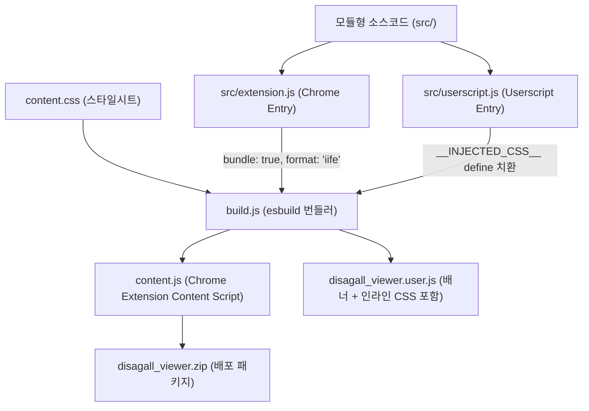

# 🏛️ [modular-bundler-migration] Architecture & Dependency Blueprint

## 1. 빌드 및 번들링 흐름도 (Mermaid Flow)

## 2. 도메인 파일 트리 및 단일 책임 (File Tree & SRP)

- **빌드 파이프라인**:
  - `build.js`: `esbuild`를 프로그래밍 방식으로 호출하여 Chrome 확장과 Userscript 번들을 원클릭 컴파일
  - `package.json`: 빌드(`npm run build`), 패키징(`npm run pack`), 테스트(`npm test`) 스크립트 정의
- **엔트리포인트**:
  - `src/extension.js`: Chrome Manifest V3 Content Script 엔트리 (`chrome.runtime.onMessage` 리스너 바인딩)
  - `src/userscript.js`: Tampermonkey/Safari Userscript 엔트리 (`GM_addStyle`, 전역 `V` 단축키 바인딩)
- **산출물**:
  - `content.js`: 번들링된 Chrome 확장용 실행 파일
  - `disagall_viewer.user.js`: 유저스크립트 메타데이터 배너 및 인라인 CSS가 결합된 단일 파일
  - `disagall_viewer.zip`: 웹스토어 배포용 압축 패키지

## 3. 타 도메인 참조 및 경계 계약 (Cross-Domain Dependencies)
- **모든 도메인의 빌드 SSOT**:
  - `core-viewer`, `post-navigation`, `post-recommend`, `viewer-immersion` 등 모든 도메인은 `src/` 하위 모듈로 개발되며, 본 빌드 파이프라인을 통해서만 배포 번들로 컴파일됨.
  - `content.js` 또는 `disagall_viewer.user.js` 직접 수정을 절대 금지하고 `src/` 수정을 강제함.

## 4. 계층 의존성 및 전역 제약 준수
- 전역 아키텍처 헌법([`00_core_foundation/architecture.md`](../00_core_foundation/architecture.md)) 준수:
  - 타겟 브라우저: `chrome100`, `firefox100`, `safari15`
  - IIFE 포맷 컴파일을 통해 전역 네임스페이스 오염 방지
