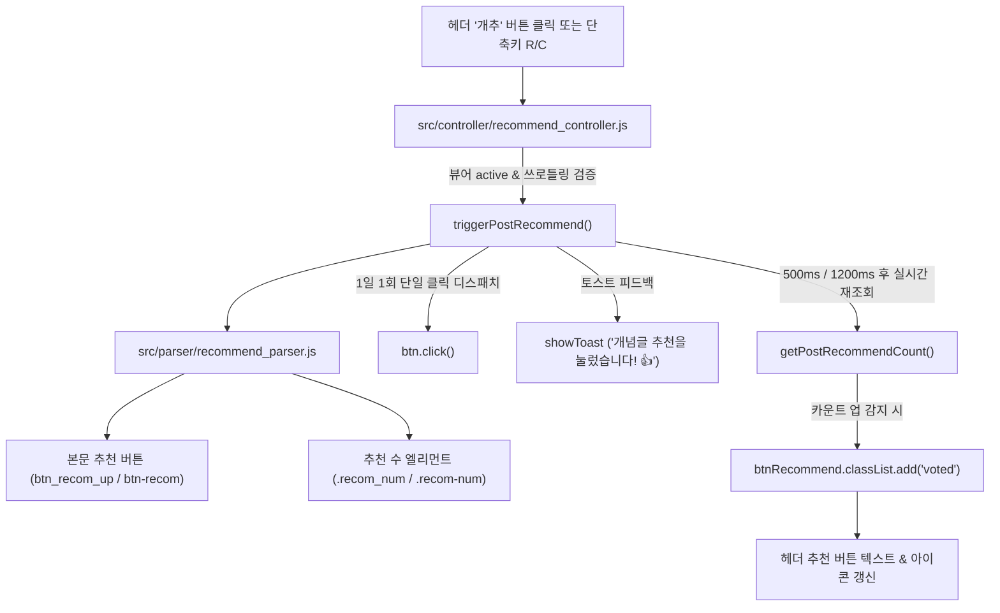

# 🏛️ [post-recommend] Architecture & Dependency Blueprint

## 1. 데이터 및 추천 흐름도 (Mermaid Flow)

## 2. 도메인 파일 트리 및 단일 책임 (File Tree & SRP)

- **도메인 파서 계층**:
  - `src/parser/recommend_parser.js`:
    - `findNativeRecommendButton()`: 데스크톱/모바일 추천 버튼 엘리먼트 쿼리
    - `getPostRecommendCount()`: 본문 마크업에서 현재 추천 수 추출 및 숫자 파싱
    - `isPostRecommendable()`: 로그인 필수/통합검색/투표불가 여부 사전 판별
- **컨트롤러 계층**:
  - `src/controller/recommend_controller.js`:
    - `triggerPostRecommend()`: 연속 클릭 쓰로틀링(1500ms), 네이티브 클릭 단일 디스패치(DEFECT-01), 2단계 카운트 갱신 타이머 관리
    - `updateRecommendButtonUi()`: 뷰어 오픈 시 최신 추천 수 동기화 및 voted 상태 렌더링
- **테스트 계층**:
  - `tests/recommend.test.js`: 버튼 탐색, 1일 1회 단일 디스패치, 기본 클래스 `on` 버그(DEFECT-02) 회귀 테스트

## 3. 타 도메인 참조 및 경계 계약 (Cross-Domain Dependencies)
- **참조 계약 (Inbound)**:
  - `core-viewer`: 뷰어 헤더 생성(`src/ui/overlay.js`) 시 `disagall-btn-recommend` 버튼을 마운트하고 클릭 리스너 연결
  - `src/state.js`: `state.elements.recommendBtnEl` 캐시 및 세션 플래그 공유
- **외부 노출 계약 (Outbound)**:
  - `handleKeyDown`에서 `R`/`C` 키 입력 시 `triggerPostRecommend()` 호출

## 4. 계층 의존성 및 전역 제약 준수
- 전역 아키텍처 헌법([`00_core_foundation/architecture.md`](../00_core_foundation/architecture.md)) 준수:
  - 추천 클릭은 1500ms 디바운스/쓰로틀을 적용하여 다중 광클릭으로 인한 디시 서버의 어뷰징 차단 및 중복 팝업 방어
