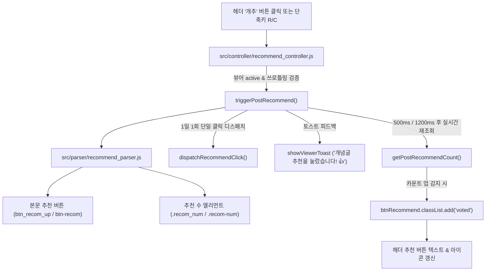

# 🏛️ [post-recommend] Architecture & Dependency Blueprint

## 1. 데이터 및 추천 흐름도 (Mermaid Flow)

## 2. 도메인 파일 트리 및 단일 책임 (File Tree & SRP)

- **도메인 파서 계층**:
  - `src/parser/recommend_parser.js`:
    - `getNativeRecommendButton()`: 우선순위 셀렉터 기반 데스크톱/모바일 추천 버튼 엘리먼트 쿼리(뷰어 UI 배제)
    - `getPostRecommendCount()`: 본문 마크업에서 현재 추천 수 추출 및 정수 파싱(실패 시 `null`)
    - `isRecommendButtonDisabled()`, `isUserLoggedIn()`, `isGalleryCodeEnforced()`, `dispatchRecommendClick()`: 버튼 활성·로그인·캡차 코드·단일 클릭 디스패치 제어
- **컨트롤러 계층**:
  - `src/controller/recommend_controller.js`:
    - `triggerPostRecommend()`: 연속 클릭 쓰로틀링(`1200ms`), 네이티브 클릭 단일 디스패치(DEFECT-01/03), 2단계 카운트 갱신 타이머(`state.recommendTimers`) 관리
    - `updateRecommendButtonUi()`: 뷰어 오픈 시 최신 추천 수 동기화 및 voted/잠금 아이콘 상태 렌더링
- **테스트 계층**:
  - `tests/recommend.test.js`: 버튼 탐색, 1일 1회 단일 디스패치, 기본 클래스 `on` 버그(DEFECT-02), 셀렉터 배제·실패 처리(DEFECT-03) 회귀 테스트

## 3. 타 도메인 참조 및 경계 계약 (Cross-Domain Dependencies)
- **참조 계약 (Inbound)**:
  - `core-viewer`: 뷰어 헤더 생성(`src/ui/overlay.js`) 시 `disagall-btn-recommend` 버튼을 마운트하고 클릭 리스너 연결
  - `src/state.js`: `state.elements.recommendBtnEl` 캐시 및 타이머(`recommendTimers`, `recommendUnlockTimer`) 공유
- **외부 노출 계약 (Outbound)**:
  - `handleKeyDown`에서 `R`/`C` 키 입력 시 `triggerPostRecommend()` 호출

## 4. 계층 의존성 및 전역 제약 준수
- 전역 아키텍처 헌법([`00_core_foundation/architecture.md`](../00_core_foundation/architecture.md)) 준수:
  - 추천 클릭은 `1200ms` 쓰로틀(`CONFIG.RECOMMEND_THROTTLE_MS`)을 적용하여 다중 광클릭으로 인한 디시 서버 어뷰징 차단 및 중복 팝업 방어
